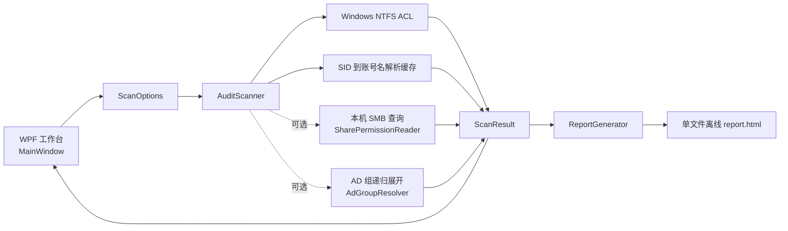

# 架构与数据流

## 组件关系

## 扫描流程

`MainWindow` 验证根目录和层级后构造 `ScanOptions`，以异步方式调用 `AuditScanner.ScanAsync`。根路径先规范化为完整路径，然后从第 1 层开始按层处理：

1. `Parallel.ForEachAsync` 以 `MaxDegreeOfParallelism` 限制并发。自动值按处理器数计算并夹在 4–32；手动值限制在 1–64。
2. 对目录读取 `AccessControlSections.Access`，并取得显式与继承规则。身份以 SID 为基础解析成账号名；本地解析失败时保留 SID。
3. 记录 ACL 读取状态和逐目录异常，然后枚举下一层子目录。重解析点不进入下一层；根自身若为重解析点，则只采集根 ACL。
4. 每处理一个目录就发送 `ScanProgress`。完成后将记录按层级和路径排序，并从权限集合计算目录数、ACL 数、唯一主体数、显式数和继承数。
5. 需要 SMB 时，只对本地路径运行 Windows PowerShell 的 `Get-SmbShare` / `Get-SmbShareAccess` 查询。UNC 扫描会记录未查询远程共享的提示。
6. 需要 AD 展开时，按 SID/身份去重查询当前登录可见的主体。嵌套组递归时保留树结构，并为每条递归路径维护祖先集合以避免循环。

目录、权限和问题均保存在内存的 `ScanResult` 中。扫描取消时保留已完成记录；由于取消发生时还有部分目录可能尚未处理，这不是完整快照。出现 ACL、枚举、SMB 或 AD 问题也会把结果标记为不完整。

## 模型语义

- `DirectoryRecord.Level` 从 1 开始；`ParentPath` 是树关系的键。
- `PermissionEntry.Identity` 是给用户查看的账号名，`Sid` 是稳定的主体标识；两者都应保留。
- `RightsRaw` 和 `RightsMask` 分别是权限枚举文本和数值掩码。`FriendlyRights` / `RightsCategory` 是展示层的常见权限分类。
- `AccessType` 保留 Allow/Deny；`IsInherited` 保留显式/继承差异；`InheritanceFlags` 和 `PropagationFlags` 保留传播语义。
- `ScanResult.Status` 只描述 Complete、Incomplete、Cancelled。它不表示用户是否能最终访问某文件。
- `ResolvedAdMemberCount` 是解析到的成员节点累计数，不是唯一 AD 身份数；同一成员可能通过不同组再次出现。

## 工作台与报表

WPF 界面由 `MainWindow` 持有一次扫描的结果。`BuildDirectoryTree` 用 `ParentPath` 建立 `DirectoryNode`；选择目录后权限表只显示该目录规则，权限搜索也只过滤当前目录。目录搜索会保留匹配节点及其祖先路径。全局账号/权限跳转搜索位于 HTML 报表中。

保存时 `ReportGenerator` 把 `ScanResult` 投影为报表专用数据，按工作台当前选择的语言生成文案。CSS、JavaScript、标签和扫描数据全部写进单个 HTML。浏览器端先建立目录索引，再按需创建目录树子节点；“全部展开”分批处理，以免一次创建大量节点阻塞浏览器。

报表内权限搜索覆盖全部目录、账号、权限原值/掩码、Allow/Deny、显式/继承及已展开的 AD 成员；搜索结果可定位到目录。报告只展示采集到的 ACL 与可选组关系，不计算有效权限。

## 本地化

WPF 的文本资源位于 `Resources/Strings.zh-CN.xaml` 和 `Resources/Strings.en-US.xaml`，`App.SetLanguage` 替换应用的资源字典。`DataGridColumn` 不是普通的可视树元素，不能假设 `DynamicResource` 标题一定随字典切换；`MainWindow.UpdateLocalizedHeaders` 会显式刷新三张表的列标题。报表文案由 `ReportGenerator.GetLabels` 单独维护，改动时需要两处同步。
